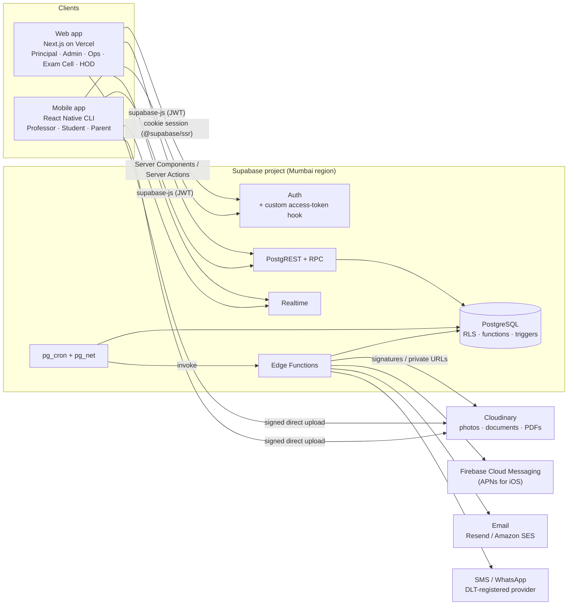
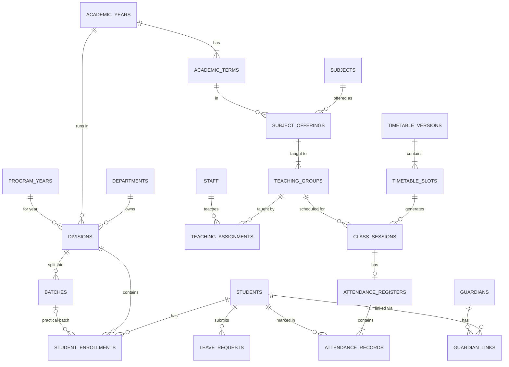
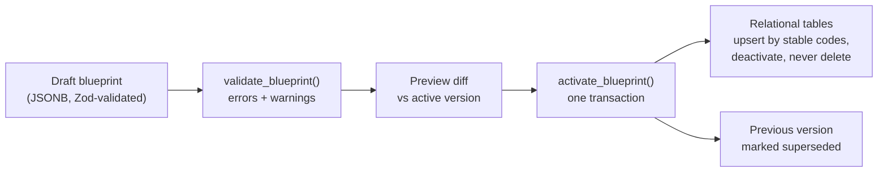
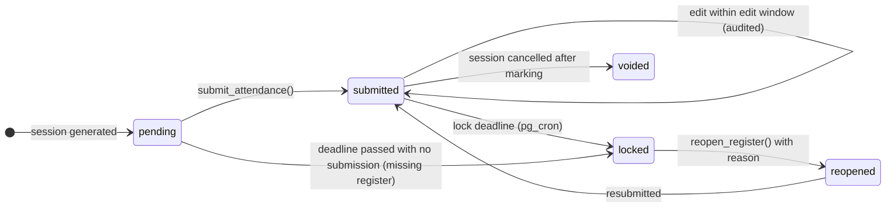
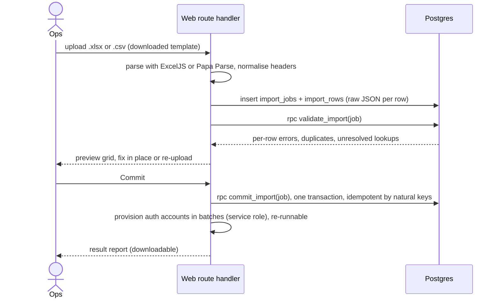
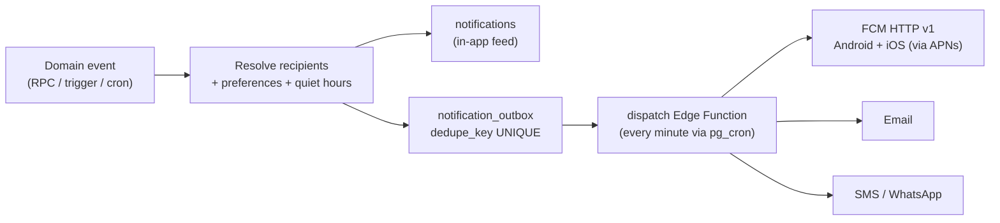

# Web Application Architecture

**Engineering College Attendance Management System: Single-Tenant Edition**

| | |
|---|---|
| Document | Web application and shared backend architecture |
| Applies to | `Webapp/web-app` (Next.js) and `Webapp/supabase` (database, auth, functions, jobs) |
| Companion | [MobileApp_Architecture.md](MobileApp_Architecture.md) |
| Inputs | *Feature Blueprint & Product Requirements (Single-Tenant)*, *Engineering College Hierarchy* (Mumbai University structure) |
| Stack | Next.js · TypeScript · Tailwind CSS · Supabase (PostgreSQL) · Cloudinary |
| Status | Draft v0.1, 2026-10-25 |

---

## 1. Purpose and scope

This document describes how the web application is built and how the shared Supabase backend is organised. There is **one web application for every web user**. Navigation, dashboards and actions are chosen by the signed-in user's role.

The mobile app (Professors, Students, Parents) uses the same backend. This document is the source of truth for the **data model, roles and permissions, attendance engine, notifications, background jobs and security**. The mobile document refers back to these sections.

### 1.1 Web users

| Role | Primary use of the web app |
|---|---|
| **Principal** | College-wide oversight, approvals, comparisons, reports |
| **Admin** | Setup wizard, academic blueprint, users and permissions, policies, integrations |
| **Operations** | Students, staff, guardians, imports, timetables, session changes, attendance monitoring, announcements |
| **Exam Cell** | Exam timetables, exam attendance, exam reports, detention/eligibility lists |
| **HOD** | Department-scoped oversight: attendance, faculty submission status, timetable drafts, staff leave, corrections |

HOD comes from the hierarchy diagram, where each department is managed by its HOD. Professors, students and parents use the mobile app. If a mobile-only user signs in on the web, they see a page that links to the app. Adding a faculty area to the web later only needs new routes and navigation entries. The architecture does not change.

### 1.2 Architecture principles

1. **Single tenant with no tenant plumbing.** One Supabase project, one database and one `college` row. There is no `institute_id`. A second college gets its own deployment.
2. **The blueprint is data.** Branches, years, divisions, batches, subjects, attendance statuses, exam types and policies are stored as rows. The college can change its structure from the admin panel with no migration or code change.
3. **Authorization is enforced on the server.** Postgres Row Level Security (RLS) and checks inside RPCs are the final gate for every read and write. Hiding a button in the UI is only a convenience.
4. **One attendance engine.** Submission, locking, correction and calculation rules live in Postgres functions, so web and mobile behave identically.
5. **Attendance belongs to a scheduled session.** Every record points at a `class_sessions` row, never only at a date or subject.
6. **History is never rewritten.** Structural assignments are effective-dated, attendance snapshots its context, and nothing referenced by attendance is hard-deleted.
7. **Every sensitive change is audited** with the actor, time, before and after values, and the reason.

---

## 2. System context



**The mobile app talks to Supabase directly. It does not go through Next.js.** Next.js is the web app's server. It handles rendering, Server Actions, and a few Route Handlers for file import and export. It is not a general-purpose API. This gives both clients one auth model (JWT + RLS), removes a network hop, and means web deployments cannot break the mobile app.

---

## 3. Technology stack

| Concern | Choice | Notes |
|---|---|---|
| Framework | **Next.js (App Router, v15+)**, React, TypeScript `strict` | Server Components by default |
| Styling | **Tailwind CSS v4** | Design tokens come from `src/shared/tokens.ts`, which the mobile app also uses (through a synced copy) |
| Components | shadcn/ui (Radix primitives) | Components are copied into the repo and owned by it. They are accessible and themeable |
| Data grids | TanStack Table | Pagination, sorting and filtering run on the server |
| Forms | React Hook Form + Zod | Zod schemas live in `src/shared/schemas` and are synced to mobile |
| URL state | nuqs | Filters (year, term, branch, division) live in the URL, so they are shareable and survive the back button |
| Charts | Recharts | Dashboards and trends |
| Dates | date-fns + date-fns-tz | Everything is displayed in `Asia/Kolkata` |
| Supabase client | `@supabase/ssr`, `@supabase/supabase-js` | Cookie-based sessions on the server |
| Excel / CSV | ExcelJS (read and write, templates with dropdowns), Papa Parse (CSV) | |
| PDF | `@react-pdf/renderer` | Registers, shortage lists, timetables, hall tickets |
| Database | Supabase Postgres + `btree_gist`, `pg_cron`, `pg_net`, `pgtap` | |
| Media | Cloudinary | Signed uploads. Sensitive files use `authenticated`/`private` delivery |
| Email | Resend or Amazon SES | Also configured as the Supabase Auth SMTP |
| SMS / WhatsApp | DLT-compliant Indian provider (e.g. MSG91, Gupshup), WhatsApp Cloud API | Optional and off by default |
| Secrets | Supabase Vault (DB-side), Vercel environment variables (web) | |
| Monitoring | Sentry, Vercel Analytics, Supabase Logs | |
| Project layout | Two independent projects, no workspace tooling | See §4 |
| Testing | Vitest, Playwright, pgTAP | |

---

## 4. Project layout

The web app and the mobile app are **two independent projects in separate folders**. Each has its own `package.json`, lockfile, `node_modules`, lint configuration and CI job. There is no workspace tooling.

```
college-attendance-system/
├── webapp_Architecture.md, MobileApp_Architecture.md, blueprint PDF, hierarchy image
│
├── Webapp/
│   ├── web-app/                     # Next.js project (this document)
│   │   ├── src/
│   │   │   ├── app/ features/ components/ lib/      (§10.1)
│   │   │   ├── shared/              # SOURCE OF TRUTH for code both apps use (pure TypeScript)
│   │   │   │   ├── schemas/         #   Zod schemas
│   │   │   │   ├── permissions.ts   #   permission keys
│   │   │   │   ├── errors.ts        #   DB error code → user message
│   │   │   │   ├── attendance.ts    #   percentage, eligibility, sessions-needed maths
│   │   │   │   ├── tokens.ts        #   design tokens (colours, spacing, radius, type)
│   │   │   │   └── dates.ts         #   IST helpers
│   │   │   └── types/database.ts    # generated by `supabase gen types`, never hand-edited
│   │   └── package.json
│   │
│   └── supabase/                    # the shared backend (owned by the web side)
│       ├── migrations/              # schema, RLS, functions, triggers (the only way the DB changes)
│       ├── functions/               # Edge Functions (Deno)
│       ├── tests/                   # pgTAP: RLS matrix + RPC behaviour
│       ├── seed/                    # default Mumbai-University engineering blueprint + dev fixtures
│       └── config.toml
│
└── MobileApp/
    └── mobile-app/                  # React Native CLI project (MobileApp_Architecture.md)
        ├── src/shared/              # synced copy of Webapp/web-app/src/shared (never edited here)
        ├── src/types/database.ts    # generated by `supabase gen types`
        └── package.json
```

Rules:

- **The backend lives in `Webapp/supabase`.** The web pipeline applies migrations and deploys Edge Functions. The mobile project consumes the backend and never changes the schema.
- **Database changes only through migrations.** Staging and production databases change only through migrations in `Webapp/supabase/migrations`. Nobody edits schema from the dashboard.
- **Shared code has one source of truth: `Webapp/web-app/src/shared/`.**
  - Its only dependencies are `zod` and `date-fns`, with no React, Next.js or React Native imports, so it runs in both apps.
  - The mobile project's `scripts/sync-shared.mjs` copies it into `mobile-app/src/shared/` and stamps each file "generated, edit in Webapp".
  - Mobile CI runs the sync and fails if anything changes.
- **Database types are generated in each project.** Both run `supabase gen types typescript` (`--local` in development, `--project-id` for staging) into `src/types/database.ts`. CI fails if the committed file is stale.
- **Design tokens** come from `shared/tokens.ts`. The web project maps them into its Tailwind v4 `@theme`, and the mobile project maps them into NativeWind's `tailwind.config.js`.
- **Use one git repository at the root** holding both folders. A schema change and the app changes that depend on it then land in the same commit. CI uses path filters: `Webapp/**` runs the web and database pipeline, and `MobileApp/**` runs the mobile pipeline. If the projects later move to separate repositories, the sync script still works when both are checked out side by side.
- **Keep folder names and the full path free of spaces, and short.** React Native's Android native (CMake) builds and some iOS build scripts can fail on paths with spaces. Windows also limits paths to 260 characters, which deep `node_modules` trees can exceed.

---

## 5. Roles, permissions and scope

### 5.1 Roles

Roles are rows in `user_roles`, and one user can hold several. For example, an HOD also holds the `professor` role.

| Role key | Client | Where the scope comes from |
|---|---|---|
| `principal` | Web | Whole college |
| `admin` | Web | Whole college |
| `operations` | Web | Whole college |
| `exam_cell` | Web | Whole college (exam data) |
| `hod` | Web (and mobile through `professor`) | `department_staff` row with `role = 'hod'` that is valid today |
| `professor` | Mobile | `teaching_assignments` and `session_staff` |
| `student` | Mobile | Self |
| `parent` | Mobile | Verified `guardian_links` |

**Class Teacher and Academic Coordinator are assignments, not login roles.** A `class_teacher_assignments` row (professor × division × date range) grants extra capabilities for that division, such as approving leave and messaging the class.

### 5.2 Permissions with scopes

Permission keys are defined in `src/shared/permissions.ts` and seeded into `permissions`. `role_permissions (role, permission, scope)` maps roles to permissions. Admin can edit it, as the blueprint requires.

```
settings.manage           roles.manage              audit.view
blueprint.view            blueprint.manage          blueprint.activate
calendar.manage           year.rollover
students.view             students.manage           students.import        students.promote
guardians.manage
staff.view                staff.manage              staff.import           assignments.manage
timetable.view            timetable.edit            timetable.publish      sessions.manage
attendance.view           attendance.mark           attendance.override    attendance.reopen
attendance.correct.approve                          attendance.policy.manage
leave.student.decide      leave.staff.decide
exams.manage              exams.attendance.mark
announcements.college     announcements.class
reports.view              reports.export
```

Every grant has a **scope**, which is one of `all`, `department`, `assigned`, `self` or `linked`. Examples:

- HOD → `attendance.view @ department`
- Professor → `attendance.mark @ assigned`
- Student → `attendance.view @ self`
- Parent → `attendance.view @ linked`

### 5.3 Default permission matrix (web roles)

✓ = full, **D** = own department, **R** = read only, **—** = none.

| Module | Principal | Admin | Operations | Exam Cell | HOD |
|---|:-:|:-:|:-:|:-:|:-:|
| College settings, roles, integrations | ✓ | ✓ | R | — | — |
| Academic blueprint & calendar | ✓ | ✓ | R | R | R (D) |
| Year rollover & promotion | ✓ | ✓ | prepare | — | — |
| Students & guardians | ✓ | ✓ | ✓ | R | R (D) |
| Staff & teaching assignments | ✓ | ✓ | ✓ | R | D |
| Semester timetable | ✓ | ✓ | ✓ (publish) | R | D (draft) |
| Session changes (cancel / reschedule / substitute) | ✓ | ✓ | ✓ | — | D |
| Attendance monitoring | ✓ | ✓ | ✓ | R (shortage / eligibility) | D |
| Attendance correction approval / reopen | ✓ | ✓ | ✓ | — | D |
| Attendance policies | ✓ | ✓ | — | — | — |
| Exams & exam attendance | ✓ | ✓ | R | ✓ | R (D) |
| Student leave oversight | ✓ | ✓ | ✓ | — | D |
| Staff leave approval | ✓ (HODs) | — | — | — | D |
| Announcements | ✓ college | ✓ college | ✓ college | ✓ exam notices | D |
| Reports & exports | ✓ | ✓ | ✓ | ✓ (exams) | D |
| Audit log | ✓ | ✓ | — | — | — |

Principal and Admin have the same reach. They differ in default dashboard and in who is expected to do configuration work.

### 5.4 Enforcement at three layers

1. **Navigation.** `nav.config.ts` lists `{ href, label, icon, permission }`. The sidebar shows only the entries the user is permitted to see.
2. **Next.js server.** Every route-group layout calls `requirePermission()`. Every Server Action and Route Handler goes through the `action()` wrapper in [§10.4](#104-mutation-pattern), which checks authentication, active status, permission and input.
3. **Database.** RLS policies and the checks inside `SECURITY DEFINER` RPCs apply here. If someone bypasses layers 1–2 by calling PostgREST directly with a valid JWT, the database still refuses.

### 5.5 How identity reaches the database

- A Supabase **Custom Access Token Hook** (a Postgres function) adds claims at sign-in and on every refresh. The claims are `app_roles` (for example `["professor","hod"]`), `staff_id`, `student_id` and `guardian_id`.
- Permissions and scopes are **looked up from `role_permissions` at query time** rather than embedded in the JWT. An admin's permission edits therefore take effect immediately.
- Role *membership* changes take effect at the next token refresh. JWT expiry is set to 15 minutes.
- Deactivating an account sets `profiles.is_active = false`, bans the auth user (which blocks refresh) and revokes their sessions. Every write RPC also checks `is_active`, so an access token that has not yet expired still cannot write.

Helper functions live in a private `app` schema. It is not exposed by PostgREST, and `authenticated` has `USAGE` on it.

```sql
create schema if not exists app;
grant usage on schema app to authenticated;

-- does the caller hold `perm` with `scope` through any of their roles?
create or replace function app.can(perm text, scope text) returns boolean
language sql stable security definer set search_path = '' as $$
  select exists (
    select 1 from public.role_permissions rp
    where rp.permission = perm
      and rp.scope      = scope
      and (auth.jwt() -> 'app_roles') ? rp.role
  )
$$;

create or replace function app.is_guardian_of(p_student uuid) returns boolean
language sql stable security definer set search_path = '' as $$
  select exists (
    select 1 from public.guardian_links gl
    where gl.student_id = p_student
      and gl.guardian_id = (auth.jwt() ->> 'guardian_id')::uuid
      and gl.status = 'verified'
  )
$$;
```

Example policy. **Attendance tables have no INSERT/UPDATE/DELETE policies.** All writes go through RPCs ([§8](#8-attendance-engine)).

```sql
alter table public.attendance_records enable row level security;

create policy attendance_records_select on public.attendance_records
for select to authenticated using (
     (select app.can('attendance.view', 'all'))
  or ((select app.can('attendance.view', 'department'))
        and department_id = any ((select app.my_department_ids())))
  or ((select app.can('attendance.view', 'assigned'))
        and app.teaches_session(session_id))
  or ((select app.can('attendance.view', 'self'))
        and student_id = (select app.my_student_id()))
  or ((select app.can('attendance.view', 'linked'))
        and app.is_guardian_of(student_id))
);
```

> Wrapping argument-free helpers in `(select …)` makes Postgres evaluate them once per statement instead of once per row. Supabase's RLS performance guidance recommends this.

---

## 6. Authentication and account lifecycle

| Persona | Sign-in method | Notes |
|---|---|---|
| Principal, Admin | Email + password + **TOTP MFA (required)** | RLS on roles, permissions and policy tables requires `aal2` |
| Operations, Exam Cell, HOD | Email + password (MFA recommended), or Google Workspace SSO if the college has a domain | |
| Professors, Students (mobile) | Email + password | Accounts are provisioned by Ops |
| Parents (mobile) | Email + password | Login issued by Ops/Admin from People → Guardians: the parent's email is the username and the admin hands over a generated password. No SMS / OTP sign-in |

- **No public sign-up.** Sign-ups are disabled in Supabase Auth. Accounts are created by Ops or Admin, individually or through imports. The new user receives an invite and sets a password on first login.
- **Account recovery.** Everyone uses password-reset email ("Forgot password?"). Ops can also issue a parent a new password from People → Guardians.
- **Web sessions.** `@supabase/ssr` stores the session in cookies. `proxy.ts` (named `middleware.ts` before Next.js 16) refreshes the session and redirects unauthenticated users to `/login`. It does no authorization. On the server, identity comes from `supabase.auth.getClaims()` or `getUser()`, never from `getSession()`.
- **Bot protection.** Cloudflare Turnstile protects login and password reset, using Supabase Auth's CAPTCHA support.
- **First run.** If the `college` row does not exist, every route redirects to `/setup`. The first admin account is created from the CLI using the service role (`npm run bootstrap:admin`).

---

## 7. Domain model

### 7.1 Mapping the Mumbai University hierarchy

```
Principal
 └─ Department / Branch (HOD)  COMP · CSE · IT · AIML · AIDS · DS · ENTC · ELEX · ELEC · MECH · CIVIL · CHEM
     └─ Academic Year (2026-27)
         └─ Program Year (FE / SE / TE / BE)
             └─ Semester (1–8; odd terms Jul–Nov, even terms Jan–May)
                 └─ Division (A, B, C …)
                     └─ Batch (1, 2, 3 … for practicals / tutorials)
                         └─ Subject offering → Teaching group → Scheduled session → Attendance record
```

| Concept | Table | Notes |
|---|---|---|
| College | `college` | Exactly one row (`check (id = 1)`). Holds name, logo, address, contacts, principal, timezone `Asia/Kolkata`, affiliating university |
| Department / branch | `departments` | Seeded with the 12 branches. An optional **Humanities & Applied Sciences** department can own FE teaching staff |
| HOD / staff membership | `department_staff` | `role` (hod, faculty, lab_staff) with a `valid_during` daterange |
| Academic year | `academic_years` | `2026-27`, start and end, status `planned / active / archived` |
| Term | `academic_terms` | Two per year: odd (Sem 1/3/5/7) and even (Sem 2/4/6/8), with teaching weeks |
| Program year | `program_years` | FE = 1, SE = 2, TE = 3, BE = 4 |
| Semester | `semesters` | 1–8, each linked to a program year and a term parity |
| Division | `divisions` | Per academic year × department × program year, with code and capacity |
| Batch | `batches` | Belongs to a division. Used for practicals and tutorials |
| Subject | `subjects` | Catalogue per curriculum scheme (e.g. Rev-2019 "C-Scheme", NEP-2020). Holds credits and components (TH / PR / TUT) with weekly hours |
| Subject offering | `subject_offerings` | A subject taught in a specific term to a department and program year |
| Teaching group | `teaching_groups` | **Who attends.** One of: a whole division (theory), a batch (practical/tutorial), or a custom group (an elective spanning divisions) |
| Teaching assignment | `teaching_assignments` | Professor ↔ teaching group, role `primary / co / substitute`, effective dates. This is `lecturer_assignments` in the hierarchy diagram |

> **Why teaching groups?** The diagram puts `division_id`/`batch_id` directly on `subject_offerings`. That breaks for MU electives (DLOC/ILOC), whose students come from several divisions. Splitting *what is taught* (offering) from *who attends* (teaching group) handles theory, practical batches and cross-division electives with one model.

### 7.2 Core entity relationships



### 7.3 Table catalogue

**Organisation and people**

| Table | Purpose / key columns |
|---|---|
| `college` | Single row: profile, logo asset, timezone, `setup_completed_at` |
| `profiles` | 1:1 with `auth.users`: display name, email, phone, `is_active`, `last_seen_at` |
| `user_roles` | `(user_id, role)` unique |
| `permissions`, `role_permissions` | Permission catalogue and `(role, permission, scope)` grants |
| `staff` | `employee_id` unique, designation, home department, joining date, status, `user_id` |
| `department_staff` | Staff × department × role × `valid_during` |
| `students` | `enrollment_no` unique, `prn` (MU Permanent Registration Number, unique and nullable), name, DOB, gender, contacts, admission year, `admission_type` (`fe_regular`, `direct_second_year`), admitted branch, status, photo asset, `user_id` |
| `guardians` | Name, relation, verified phone, email, `user_id` (null until activated) |
| `guardian_links` | Student × guardian, `status` (`pending / verified / revoked`), `is_primary`, `verified_by`, `verified_at` |
| `student_documents` | Document type, media asset, verification state |

**Academic structure and calendar**

| Table | Purpose / key columns |
|---|---|
| `academic_years`, `academic_terms`, `program_years`, `semesters` | See §7.1 |
| `departments`, `divisions`, `batches` | See §7.1. `unique (academic_year_id, department_id, program_year_id, code)` on divisions |
| `rooms` | Classroom / lab / seminar hall, capacity, department |
| `period_templates` | Daily slot timings, breaks, lecture duration, Saturday pattern (e.g. 1st and 3rd Saturdays working) |
| `academic_calendar_events` | Holidays, exam blocks, events, working-day overrides |
| `blueprint_versions` | Draft, active and superseded blueprint documents (JSONB) with a validation report ([§7.6](#76-blueprint-versioning)) |
| `curriculum_schemes`, `subjects`, `subject_components`, `elective_baskets` | Subject catalogue and DLOC/ILOC baskets |

**Enrollment and teaching**

| Table | Purpose / key columns |
|---|---|
| `student_enrollments` | **One row per student per term.** Holds academic year, term, department, program year, semester, division, batch, `roll_no`, `enrollment_type` (`regular / atkt / repeat / dse`), `is_primary`, `valid_during`, reason, `created_by` |
| `student_subject_registrations` | Electives and backlog registrations: student × offering × custom teaching group × `valid_during` |
| `subject_offerings`, `teaching_groups`, `teaching_assignments` | See §7.1 |
| `class_teacher_assignments` | Division × staff × `valid_during` |

**Timetable and sessions**

| Table | Purpose / key columns |
|---|---|
| `timetable_versions` | Term × department × program year, status `draft / published / archived`, `effective_from`, source file asset, `published_by` |
| `timetable_slots` | Weekday, start, end, teaching group, room, `session_type`, staff list |
| `class_sessions` | Concrete dated session: date, `starts_at`, `ends_at`, teaching group, offering, component, `session_type` (`theory / practical / tutorial / seminar / extra / remedial`), room, `status` (`scheduled / held / cancelled / rescheduled`), `rescheduled_from_id`, `source_slot_id`, `attendance_weight`, denormalised `department_id` and `term_id` |
| `session_staff` | Session × staff × role (`primary / co / substitute`) |

**Attendance**

| Table | Purpose / key columns |
|---|---|
| `attendance_status_codes` | `P, A, L, OD, ML, EX …`: label, colour, `counts_as_attended`, `counts_in_held`, `professor_can_set`, `requires_reason` |
| `attendance_policies` | Scope (`college / department / program_year / subject`), component, `min_percent`, `warn_percent`, `count_mode` (`session / hours`), `eligibility_basis`, `default_unmarked_status`, `edit_window_hours`, `lock_after_hours`, leave treatment, effective dates |
| `attendance_registers` | One per session: `state`, `version`, `submitted_by/at`, `client_submission_id` (unique), `client_marked_at`, `device_id`, `locked_at`, reopen fields, counts |
| `attendance_records` | `(session_id, student_id)` unique: `status_code`, `source` (`manual / bulk / leave / correction / override / qr`), `marked_by/at`, **snapshot** of `division_id`, `batch_id`, `department_id`, `term_id`, `session_date` |
| `attendance_record_history` | Append-only before/after for every change made after first submission |
| `attendance_summaries` | Student × offering × component: `held`, `attended`, `excused`, `percent`, `updated_at` |
| `attendance_correction_requests` | Raised by a professor after lock: records, proposed status, reason, evidence, approver, decision |
| `attendance_disputes` | Raised by a student or parent against a record: message thread, status, resolver |

**Leave, exams, communication, platform**

| Table | Purpose / key columns |
|---|---|
| `leave_types`, `leave_requests`, `leave_request_sessions` | Full-day, half-day and session leave. `leave_period tstzrange`, status (`pending / needs_info / approved / rejected / cancelled`), routing, decision, resolved sessions |
| `staff_leave_requests` | Staff leave with an approval chain and substitute arrangements |
| `exam_types`, `exams`, `exam_sessions`, `exam_attendance`, `exam_duties` | Configurable exam names (IAET-1, IAET-2, practical, viva, mid-sem, end-sem). Exam attendance is kept **separate** from lecture attendance |
| `announcements`, `announcement_audiences`, `announcement_recipients` | Content, targeting, scheduled publish, and per-recipient delivery and read tracking |
| `notifications` | In-app notification centre (per user) |
| `notification_outbox` | Channel, recipient, template, payload, **`dedupe_key` unique**, status, attempts, `next_attempt_at`, provider id |
| `notification_preferences`, `device_tokens` | Per user × event × channel. FCM registration tokens per device (platform, app version, last seen) |
| `audit_log` | Append-only: actor, action, entity, before/after JSONB, reason, IP, user agent, timestamp |
| `import_jobs`, `import_rows` | Staged imports with row-level validation results |
| `media_assets` | Cloudinary `public_id`, resource and delivery type, purpose, owner entity, bytes |
| `report_jobs` | Large asynchronous exports |
| `app_config` | `min_mobile_version`, feature flags, maintenance banner |

### 7.4 Business rules from the hierarchy diagram, enforced in the schema

| # | Rule | Enforcement |
|---|---|---|
| 1 | Each department has a configurable HOD with an effective date | `department_staff.valid_during` + exclusion constraint (one HOD at a time) |
| 2 | Each division belongs to a department, program year and academic year | `NOT NULL` foreign keys + unique `(year, dept, program_year, code)` |
| 3 | Each batch belongs to a division or an explicit practical group | `batches.division_id NOT NULL`. Cross-division groups are `teaching_groups.kind = 'custom'` |
| 4 | Each student has one valid primary enrollment | Exclusion constraint below, plus a validation report listing active students with no enrollment |
| 5 | Division-wide theory and batch-wise practicals | `teaching_groups.kind` (`division / batch / custom`) |
| 6 | Progression updates enrollment rather than duplicating the student | `students` is permanent. Each term or year adds `student_enrollments` rows |
| 7 | Division, batch and lecturer changes keep historical attendance | Effective dating + attendance snapshots ([§7.5](#75-preserving-history)) |

```sql
create extension if not exists btree_gist;

-- Rule 4: never two overlapping primary enrollments for a student
alter table public.student_enrollments
  add constraint one_primary_enrollment
  exclude using gist (student_id with =, valid_during with &&) where (is_primary);

-- Rule 1: one HOD per department at any moment
alter table public.department_staff
  add constraint one_hod_per_department
  exclude using gist (department_id with =, valid_during with &&) where (role = 'hod');

-- Lecture-level records: one record per student per session
alter table public.attendance_records
  add constraint uq_attendance_record unique (session_id, student_id);

-- No overlapping live leave requests (tstzrange so first-half / second-half can coexist)
alter table public.leave_requests
  add constraint no_overlapping_leave
  exclude using gist (student_id with =, leave_period with &&)
  where (status in ('pending', 'needs_info', 'approved'));
```

### 7.5 Preserving history

- **Effective dating.** Enrollments, department membership, teaching assignments, class-teacher assignments and guardian links have `valid_during` ranges. To change one, close the current row and open a new one. Never update in place.
- **Per-year structure.** Divisions and batches are created for each academic year, and rollover clones them. Renaming next year's "Div B" does not touch last year's.
- **Snapshots.** Each attendance record copies its division, batch, department, term and date when written. Past reports therefore never depend on today's enrollment.
- **No hard deletes** of anything attendance references. Use `archived_at` / `is_active`, with foreign keys `on delete restrict`.
- **Archived years are read-only.** A trigger rejects writes to rows that belong to an `archived` academic year, except through the audited `override_*` RPCs.

### 7.6 Blueprint versioning



- The blueprint covers structure only: departments, program years, semesters, division and batch templates, the subject catalogue and electives, period templates, status codes and policy defaults. It does not cover people or timetables.
- The seed **"Mumbai University – Engineering"** template ships the 12 branches, FE–BE, Sem 1–8, divisions A–B and batches 1–3.
- Validation examples: a division with no batches while practical subjects exist, a subject with no components, weekly hours exceeding the period template, or a duplicate code.

---

## 8. Attendance engine

This section implements the blueprint's *Critical Attendance Rules*. All of it runs inside Postgres, so web and mobile share it.

### 8.1 Session and register lifecycle

Session `status`: `scheduled → held | cancelled | rescheduled`. Register `state`:



- Professor **drafts live on the device** ([mobile doc §9](MobileApp_Architecture.md)). The server holds only submitted data.
- A register still `pending` after the session ends plus a grace period shows as **missing** on dashboards. Reminders go out automatically.
- **Cancelled sessions have no register** and never count as held. This meets the blueprint's "cancelled lectures do not inflate lectures held". If a session is cancelled after marking, its register becomes `voided`, its records stop counting, and the change is audited.

### 8.2 Roster resolution

`session_roster(session_id)` is a `STABLE` SQL function that returns who should be marked:

| Teaching group kind | Students |
|---|---|
| `division` | Primary enrollment in the division whose `valid_during` contains the session date |
| `batch` | As above, filtered to the batch |
| `custom` (elective) | `student_subject_registrations` for the group, valid on the date |

The function excludes students who were withdrawn or detained on that date. It left-joins approved leave that covers the session time and returns `suggested_status = 'L'` for those students. Three callers use it: the professor app's roster download, `submit_attendance` (to validate the submitted student set), and missing-register reports.

### 8.3 `submit_attendance` RPC

```sql
submit_attendance(
  p_session_id           uuid,
  p_client_submission_id uuid,         -- idempotency key, generated on device once per submit
  p_base_version         int,          -- register version the device started from (null = first)
  p_records              jsonb,        -- [{ "student_id": "...", "status": "P", "marked_at": "..." }]
  p_client_marked_at     timestamptz,
  p_device_id            text
) returns jsonb
-- { "result": "ok" | "duplicate" | "conflict" | "locked" | "cancelled",
--   "register": {...}, "defaulted_students": [...] }
```

The RPC runs as one transaction:

1. Lock the register row (`select … for update`). This serialises concurrent submissions from co-teachers.
2. If `client_submission_id` was already processed, return the stored result as `duplicate`. **Retries are always safe.**
3. Authorise the caller: they must be primary, co or substitute staff on the session, the account must be active, the session must not be cancelled, and the register must not be locked.
4. If the register is already submitted and `p_base_version` ≠ the current version, return `conflict` with the server copy.
5. Validate the student set against `session_roster()` and reject unknown students. Students missing from the payload get the policy's `default_unmarked_status`, usually `A`. This is the blueprint's "apply the absence rule after finalisation". They are returned in `defaulted_students` so the app can alert the professor.
6. Upsert records with snapshots. If this is an edit, write `attendance_record_history` rows. Bump `version` and set `submitted_at` from **server time**.
7. Recompute `attendance_summaries` for the affected student × offering × component keys.
8. Insert outbox events (absence alerts, "attendance published") with dedupe keys.
9. Return the result.

Every write RPC follows the same conventions:

- `security definer`, `set search_path = ''`
- The first statement is `perform app.require('permission', scope_context)`
- Errors are raised with **stable codes** such as `ATT_LOCKED` or `ATT_NOT_ASSIGNED`. `src/shared/errors.ts` maps them to user-facing messages
- `revoke execute … from public, anon`, then `grant execute … to authenticated`
- **Breaking changes create a new function** (`submit_attendance_v2`), because old mobile builds stay in use

### 8.4 Status codes and calculation

Defaults are seeded and editable in Settings:

| Code | Meaning | Counts as attended | Counts in held |
|---|---|:-:|:-:|
| `P` | Present | ✓ | ✓ |
| `A` | Absent | — | ✓ |
| `L` | Approved leave | policy (default —) | policy (default ✓) |
| `OD` | On duty (college event, sports, NSS) | ✓ | ✓ |
| `ML` | Medical leave (verified) | — | policy |
| `EX` | Excused by authority | — | — |

```
weight(r)  = 1                         when count_mode = 'session'
           = session duration in hours when count_mode = 'hours'   (2-hour practical counts 2)

held       = Σ weight(r)  over records in submitted/locked registers of non-cancelled sessions
                          whose status counts_in_held
attended   = Σ weight(r)  over those records whose status counts_as_attended
percent    = round(attended / held × 100, 2)        -- null when held = 0
```

- Calculated **per subject × component** (theory, practical, tutorial) and also rolled up per subject and overall.
- **Eligibility** follows the policy's `eligibility_basis`: `per_subject_component`, `per_subject` or `aggregate`. The threshold is `min_percent`, and MU colleges commonly use 75%.
- **Sessions needed to recover** (shown to students):
  `needed = ceil((min% × held − 100 × attended) / (100 − min%))`. The app compares this with the remaining scheduled sessions in the term to show whether the threshold is still reachable.
- The formula is implemented twice and tested against shared fixtures: in SQL for reports and summaries, and in `src/shared/attendance.ts` for instant UI feedback.

### 8.5 Summaries

`attendance_summaries` is updated incrementally inside every RPC that changes records. A nightly `reconcile_attendance_summaries()` job recomputes everything and logs any drift. Dashboards, mobile home screens and shortage lists read summaries. Drill-down views read records.

### 8.6 Edits, locking, corrections and overrides

| Situation | Who | Mechanism |
|---|---|---|
| Fix own register soon after submitting | Professor | Resubmit within `edit_window_hours`. Every changed record is written to history |
| Register past its lock deadline | System | `pg_cron` locks it every 15 minutes |
| Change after lock | Professor → HOD / Ops | `attendance_correction_requests`. On approval, `apply_correction()` updates records, keeps the **original value, new value, reason, requester, approver and timestamps**, recomputes summaries, and notifies the student and parents |
| Student or parent says a record is wrong | Student / Parent → Professor | `attendance_disputes` thread. It may lead to a correction request |
| Allow late marking | HOD / Ops | `reopen_register(session, reason, until)` |
| Administrative override | Admin / Ops | `override_attendance()` requires a reason and is always audited |

### 8.7 Leave and attendance

- On approval, the affected sessions are resolved into `leave_request_sessions`:
  - Full-day leave covers all of the student's sessions that day.
  - Half-day leave covers sessions in that half, per `period_templates`.
  - Session leave covers the listed sessions.
- **Future sessions.** The roster shows `L` as the suggested status. If the student actually attends, the professor marks `P`. Actual presence always wins over leave.
- **Past sessions already marked `A`.** If `leave_applies_retroactively` is set, these become `L` automatically as an audited correction with `source = 'leave'`.
- Cancelling an approved leave reverts only the automatic `L` records that no professor has changed since.

### 8.8 Session changes

- **Cancel:** the status becomes `cancelled` with a reason, students and staff are notified, and no register is created.
- **Reschedule:** the original session is marked `rescheduled` and a new linked session is created. Both sides are notified.
- **Substitute:** add a `session_staff` row with role `substitute`. The substitute can mark attendance, and the original professor keeps read access.
- **Extra / remedial lecture:** an ad-hoc session with no `source_slot_id`.
- **Timetable republish:** regenerates only future sessions that still have `pending` registers and no manual changes. Past or marked sessions are never touched.

---

## 9. Where logic lives

| Layer | Use it for | Examples |
|---|---|---|
| **RLS policies** | Every read by both apps. Simple owner-only writes | A student reads their own records. A guardian reads a linked child's records |
| **Postgres RPCs** (`security definer` + explicit checks) | Multi-row invariants, anything both apps call, the attendance engine | `submit_attendance`, `apply_correction`, `decide_leave`, `publish_timetable`, `promote_students`, `activate_blueprint`, `commit_import` |
| **Triggers** | Side-effects that must be atomic with the write | Audit log, `updated_at`, archived-year guard |
| **Next.js Server Actions** | Web form workflows: validate, call RPCs, revalidate | Create student, edit division, assign professor |
| **Next.js Route Handlers** | File I/O over HTTP | Import upload and parse, Excel/PDF export streaming, Cloudinary signing for web |
| **Edge Functions** | Third-party APIs and secrets, called by both apps or by cron | Notification dispatcher, Cloudinary signing and private URLs for mobile, Send-SMS auth hook, Cloudinary webhook |
| **pg_cron** | Time-based work | Locking, reminders, digests, scheduled announcements ([§16](#16-background-jobs)) |

**Rule: if both apps need it, it is an RPC or an Edge Function, never a Next.js endpoint.**

---

## 10. Next.js application

### 10.1 Folder structure

```
Webapp/web-app/src/
├── app/
│   ├── (auth)/                     # login, forgot-password, reset-password, mfa
│   ├── setup/                      # first-run wizard (only while college is not set up)
│   ├── (portal)/                   # authenticated shell: sidebar, top bar, context switcher
│   │   ├── layout.tsx              # loads claims, roles, permissions → builds nav
│   │   ├── dashboard/
│   │   ├── academics/              # blueprint, years, calendar, departments, classes, subjects
│   │   ├── people/                 # students, staff, guardians, imports
│   │   ├── timetable/              # versions, editor, daily session board
│   │   ├── attendance/             # overview, registers, corrections, shortage
│   │   ├── exams/
│   │   ├── leave/
│   │   ├── announcements/
│   │   ├── reports/
│   │   ├── audit/
│   │   └── settings/
│   ├── use-mobile-app/             # shown to professor/student/parent-only accounts
│   └── api/                        # route handlers: imports, exports, media signing
├── features/                       # one folder per domain
│   └── students/
│       ├── components/             # StudentTable, StudentForm, EnrollmentTimeline …
│       ├── queries.ts              # server-only reads ('server-only')
│       └── actions.ts              # 'use server' mutations
├── components/ui/                  # shadcn/ui primitives
├── lib/
│   ├── supabase/{server,browser,admin}.ts   # admin.ts = service role, 'server-only'
│   ├── auth/{claims,permissions,action}.ts
│   ├── nav.config.ts
│   └── errors.ts
├── shared/                         # pure TypeScript shared with mobile (§4)
├── types/database.ts               # generated Supabase types
└── proxy.ts                        # session refresh + unauthenticated redirect
```

### 10.2 Route map

| Route | Screen | Permission |
|---|---|---|
| `/setup` | First-run wizard | `admin`, only before setup |
| `/dashboard` | Role-specific dashboard ([§11.10](#1110-operations-and-role-dashboards)) | any web role |
| `/academics/blueprint` | Blueprint editor, validation, diff, versions, activation | `blueprint.view` / `blueprint.manage` / `blueprint.activate` |
| `/academics/years` | Years and terms, rollover and promotion wizard | `year.rollover` |
| `/academics/calendar` | Holidays, working days, Saturday pattern, teaching weeks | `calendar.manage` |
| `/academics/departments` | Departments, HOD assignment history | `blueprint.manage` |
| `/academics/classes` | Divisions and batches per year, class teachers | `blueprint.manage`, `assignments.manage` |
| `/academics/subjects` | Catalogue, offerings, elective baskets, teaching groups | `blueprint.manage` |
| `/people/students`, `/people/students/[id]` | Student list, **Student 360** | `students.view` |
| `/people/staff`, `/people/staff/[id]` | Staff, teaching assignments, submission activity | `staff.view` |
| `/people/guardians` | Guardians, link verification | `guardians.manage` |
| `/people/imports` | Import jobs and history | `*.import` |
| `/timetable` | Timetable versions per department and year | `timetable.view` |
| `/timetable/[versionId]` | Grid editor, conflicts, publish | `timetable.edit` / `timetable.publish` |
| `/timetable/sessions` | Daily session board: cancel, reschedule, substitute, extra | `sessions.manage` |
| `/attendance` | Overview, heatmaps, comparisons | `attendance.view` |
| `/attendance/registers` | Submission status, missing and late registers | `attendance.view` |
| `/attendance/corrections` | Correction requests and disputes queue | `attendance.correct.approve` |
| `/attendance/shortage` | Shortage and detention lists | `attendance.view` |
| `/exams`, `/exams/[examId]` | Exam setup, timetable, conflicts, publish | `exams.manage` |
| `/exams/attendance` | Exam attendance marking and reports | `exams.attendance.mark` |
| `/leave` | Student leave oversight, staff leave approvals | `leave.*.decide` |
| `/announcements` | Composer, scheduled, archive, delivery stats | `announcements.*` |
| `/reports` | Report catalogue and exports | `reports.view` |
| `/audit` | Audit log explorer with before/after diff | `audit.view` |
| `/settings/*` | College, policies, status codes, leave and exam types, roles, notifications, integrations, app config | `settings.manage`, `roles.manage` |

### 10.3 Rendering and data fetching

- **Server Components** read through the request-scoped Supabase client, which carries the user's JWT, so RLS applies. User-scoped data is never cached across requests. Only non-sensitive reference data (department list, status codes) may use tagged caching.
- **The academic context switcher** in the top bar (academic year + term) is stored in a cookie and defaults to the active year and term. Every query is scoped by it.
- **Filters live in the URL** through nuqs. Grids use server-side pagination (`.range()`), and large tables use `count: 'estimated'`.
- **Client Components** are used only for interactive parts: grids, forms, the timetable editor and charts.
- **Streaming.** Each dashboard widget is wrapped in Suspense, so a slow aggregate never blocks the page.
- **Realtime.** The operations dashboard subscribes to today's `attendance_registers` changes, so submission progress updates live.

### 10.4 Mutation pattern

```ts
// features/students/actions.ts
'use server';

import { revalidatePath } from 'next/cache';
import { action } from '@/lib/auth/action';
import { studentCreateSchema } from '@/shared/schemas';

export const createStudent = action({
  permission: 'students.manage',
  schema: studentCreateSchema,
  async run({ input, supabase }) {
    const { data, error } = await supabase.rpc('create_student', { p: input });
    if (error) throw error; // wrapper maps Postgres error codes to friendly messages
    revalidatePath('/people/students');
    return data;
  },
});
```

The `action()` wrapper resolves the claims, checks that the account is active and has the permission, parses the input with Zod, runs the action, and maps errors. It returns `{ ok: true, data }` or `{ ok: false, error, fieldErrors }`. **Server Actions are public HTTP endpoints**, so this wrapper is mandatory. Never rely on the UI hiding a button.

### 10.5 UI system

- Design tokens (colour, spacing, radius, typography) live in `src/shared/tokens.ts`. They are mapped into Tailwind v4's `@theme` here and into NativeWind on mobile, so web and mobile share a brand. Attendance status colours come from `attendance_status_codes.color`, so the web, mobile and PDF exports all match.
- shadcn/ui components, light and dark themes, WCAG AA contrast, and keyboard-first grids for operations staff working through large datasets.
- The sidebar is generated from `nav.config.ts`. The top bar has breadcrumbs, the academic context switcher and a **⌘K command palette** to jump to a student by name, enrollment number or PRN, or to a professor by employee ID.
- Layouts work down to tablet width. Principal and HOD dashboards stay usable in a phone browser.

---

## 11. Module designs

Letters refer to the sections of the Feature Blueprint.

### 11.1 Setup wizard (B)

Resumable. Its state is held in a draft `blueprint_versions` row.

1. College profile: name, logo, address, contacts, principal.
2. Template: "Mumbai University – Engineering" (default).
3. Branches: enable or disable the 12 seeded branches and add custom ones.
4. Academic year and terms, with dates.
5. Divisions and batches per branch × year (count, capacity).
6. Subjects: import the scheme catalogue or pick from the template.
7. Attendance defaults: threshold, edit window, lock window, leave treatment, counting mode.
8. Validate → activate. This sets `college.setup_completed_at`.

### 11.2 Academic blueprint and calendar (A)

- **Tree editor:** Department → Program Year → Divisions → Batches. Subjects are listed per semester with components and weekly hours. Elective baskets are edited here too.
- Validation panel, diff against the active version, version history ([§7.6](#76-blueprint-versioning)).
- **Calendar:** holidays, working-day overrides, Saturday pattern, teaching weeks and exam blocks. Session generation and "remaining sessions" both use it.

### 11.3 Academic-year rollover and promotion (B, C)

1. Create the next academic year by cloning the active blueprint into new divisions and batches.
2. Record each student's outcome, either by import or by hand: `promoted`, `promoted_atkt`, `repeat_year`, `detained`, `left`.
3. Preview each student's new enrollment: program year + 1, mapped to a division by rule (same letter, by roll order, or import).
4. Commit with `promote_students()`, one transaction per program year. This closes the old enrollments and opens new ones.
5. Admit new FE and **Direct Second Year (DSE)** students by import.
6. Archive the previous year, which makes it read-only.

Between the odd and even terms of the same year, `advance_term()` copies enrollments with the same division and batch and moves the semester to +1.

### 11.4 Students (C)

- List filtered by year, branch, division, batch and status.
- **Duplicate detection:** enrollment number, PRN, email, and phone + name + DOB.
- **Incomplete-record flags.**
- **Student 360:** profile, enrollment-history timeline, attendance summary, leave, guardians, documents and audit trail.
- **Actions:** transfer division or change batch (with an effective date), register ATKT/backlog or elective, withdraw, reactivate, link a guardian, resend invite or reset access, upload a photo or documents.

### 11.5 Guardians

- Created from the student import (guardian columns) or by hand.
- A link stays `pending` until Ops verifies it against admission records. Ops then creates the parent's app login: their email as the username and a generated password, shown once to hand over. Parents never sign in with SMS / OTP.
- Many guardians per student and many students per guardian (siblings) are supported.
- **There is no self-linking.** Knowing an enrollment number never grants access.

### 11.6 Staff (D)

Covers:

- Staff directory and bulk import
- Department membership, including HOD assignment with an effective date
- **Teaching-assignment matrix** (offering × group × professor)
- Class-teacher and academic-coordinator assignments
- Substitute management
- Each professor's timetable
- Submission activity: on-time %, late registers and missing registers

### 11.7 Semester timetable (E)

- **Versions** are scoped per term × department × program year, so each department works independently. Each moves through `draft → published → archived`.
- **Input.** There are two ways to build a timetable:
  - An Excel template with one row per slot: day, start, end, subject code, component, division or batch, professor employee ID, room.
  - A **grid editor**, where subject cards are dragged onto a period grid per division and practical batches sit in parallel lanes.
- **PDF uploads** are stored and published for viewing only. They are not parsed, because attendance needs structured slots.
- **`validate_timetable(version)`** reports:
  - Professor double-booked
  - Division or batch double-booked (theory clashing with one of that division's practical batches)
  - Room or lab double-booked
  - Room capacity smaller than the group
  - Professor not assigned to that teaching group
  - Weekly hours different from the subject configuration (warning only)

  Hard conflicts block publishing.
- **`publish_timetable(version, effective_from)`** generates `class_sessions` for the remaining term dates. It skips holidays and non-working days, applies the republish rule in [§8.8](#88-session-changes), and notifies affected users with a diff.
- The **daily session board** shows every session today by department and status, with cancel, reschedule, substitute and extra-lecture actions, plus scheduled vs held figures.

### 11.8 Examination cell (F)

- Exam types are configurable (IAET-1, IAET-2, practical, oral/viva, mid-sem, end-sem). Exam timetables come from an import or the editor.
- Practicals and vivas are mapped to batches and examiners.
- **Conflict detection** covers:
  - A student with two exams at the same time (worked out from teaching-group membership)
  - Room clashes
  - Examiner clashes
- Publishing notifies students and professors. Changes are re-notified with a diff.
- **Exam attendance** goes into `exam_attendance`, separate from lecture attendance, with `present / absent / exempted` and reasons. It is marked on the web by Exam Cell, or by invigilators on mobile in a later phase.
- Optional: seating plans, hall-ticket PDFs and exam-duty rosters.
- The shortage and detention list feeds exam eligibility ("term grant").

### 11.9 Attendance administration (G)

| Screen | Contents |
|---|---|
| Overview | Filters for year, branch, semester, division, batch, subject and professor. Division × day heatmap. Theory / practical / tutorial split. Daily, weekly, monthly and semester views |
| Registers | Every session with its register state. Missing, late, voided and reopened filters. "Nudge professor" |
| Corrections | Correction requests and disputes, with approve/reject and full history |
| Shortage & detention | Threshold-based lists per policy, eligibility status, export, notify students and parents |
| Comparisons | Branch vs branch, division vs division, batch vs batch, semester trends |
| Policies | College default plus the override tree (department → program year → subject), with effective dates |

### 11.10 Operations and role dashboards (H)

Widgets come from `dashboard_*` RPCs that return aggregates for the selected academic context and date range.

| Role | Default widgets |
|---|---|
| Principal | College attendance %, branch comparison, shortage count by branch, pending approvals, exam calendar |
| Admin | Setup health (blueprint validation, students without enrollment, unverified guardians), user counts, recent audit activity |
| Operations | Totals (students, professors, branches, divisions, batches), **today's sessions: scheduled / held / pending (live)**, missing registers, pending leave and corrections, timetable changes, shortcuts to imports and publishing |
| Exam Cell | Upcoming exams, conflicts, exam attendance pending, eligibility list status |
| HOD | Department attendance trend, faculty submission status, department shortage list, staff leave requests |

### 11.11 Leave and attendance correction (I)

- **Policy configuration:** leave types (full-day, half-day, session), whether documents are required, maximum backdating, routing, and escalation. The default routing is class teacher → HOD after N hours.
- **Web oversight queues** for Ops and HOD. Day-to-day approvals happen in the class teacher's mobile app.
- **Staff leave approvals** go to the HOD, or to the Principal for an HOD's own leave. Approving prompts the approver to arrange substitutes for the affected sessions.
- Leave effects on attendance are described in [§8.7](#87-leave-and-attendance).

### 11.12 Announcements (J)

- **Composer:** title, rich text (Markdown), attachments, priority, schedule and expiry.
- **Audience builder:** whole college, role, department, program year, division, batch, individuals, or parents of selected students.
- **Channels:** in-app and push are always on. Email, SMS and WhatsApp are optional.
- **Publishing** creates the `announcement_recipients` rows and the outbox entries, so delivery and read tracking work per person.
- **Archive and search.**

### 11.13 Reports and exports

Each report is a SQL function `report_<name>(filters jsonb)` declared `security invoker`, so RLS scopes the rows automatically. For example, an HOD only ever gets their own department.

| Report | Grouping | Formats |
|---|---|---|
| Attendance summary | College / branch / year / division / batch | xlsx, csv, pdf |
| **Muster register** (print-friendly) | Division or batch × subject × month (roll no × dates grid, A4 landscape) | pdf, xlsx |
| Student-wise report | Student × subjects × components | pdf, xlsx |
| Subject-wise report | Offering × component | xlsx, pdf |
| Professor submission report | Professor × period (on-time / late / missing) | xlsx |
| Theory vs practical | Division / batch | xlsx |
| Shortage / detention list | Policy threshold, term | xlsx, pdf |
| Leave & correction audit | Period | xlsx |
| Exam attendance | Exam × subject | xlsx, pdf |
| Scheduled vs held | Department × week | xlsx |
| Monthly / semester summary | Division | pdf, xlsx |

Exports stream from `/api/reports/[key]?format=…`. Above roughly 50k rows, the export runs as a `report_jobs` background job. The file goes to Cloudinary as a private raw asset, and the user gets an expiring download link and a notification.

### 11.14 Audit log

Filter by actor, entity, action and date. Each entry shows a side-by-side before/after JSON diff, and the list can be exported. The table is append-only: there are no UPDATE or DELETE grants, and a trigger rejects any modification. Entries capture IP and user agent from the PostgREST request headers.

### 11.15 Settings

College profile, attendance policies and status codes, leave types, exam types, notification templates and channels, quiet hours, integration credentials (stored in Supabase Vault), the role-permission editor, and app config (minimum mobile version, feature flags, maintenance banner).

---

## 12. Import pipeline



- **Supported imports:** students (with guardians and enrollment), staff, teaching assignments, subject catalogue, timetable slots, exam timetable, and results / promotion outcomes.
- **Templates** are generated by ExcelJS with dropdown data-validation lists, such as valid division codes for the selected year.
- **Commit is idempotent** on natural keys (`enrollment_no`, `employee_id`), so re-running skips rows that were already committed.
- **Auth accounts are a separate step.** Supabase Admin API calls cannot join the database transaction. Rows are created with `user_id = null`, and a re-runnable "provision accounts" step creates users, sends invites, and links them.

---

## 13. Notifications engine



| Event | Recipients | Default channels | Dedupe key |
|---|---|---|---|
| `student_marked_absent` | Guardians (+ student) | Push, instant or daily digest per preference | `absent:{session}:{student}:{user}` |
| `attendance_published` | Student | In-app (silent) | `pub:{session}:{student}` |
| `attendance_corrected` | Student, guardians | Push | `corr:{record}:{version}:{user}` |
| `shortage_warning` (weekly) | Student, guardians | Push + email | `short:{student}:{offering}:{iso_week}` |
| `repeated_absence` | Guardians, class teacher | Push | `rep:{student}:{date}` |
| `register_missing` | Professor | Push | `miss:{session}` |
| `leave_submitted` / `leave_escalated` | Approver | Push | `leave:{id}:{stage}` |
| `leave_decided` | Student, guardians | Push | `leave:{id}:decided` |
| `session_cancelled` / `timetable_changed` | Affected students, professors | Push | `tt:{session or version}:{user}` |
| `exam_published` / `exam_changed` | Students, professors | Push + email | `exam:{exam}:{rev}:{user}` |
| `announcement` | Audience | In-app + push (+ optional channels) | `ann:{id}:{user}` |

- **Dispatcher:**
  - Claims a batch with `for update skip locked` and sends it.
  - Stores provider message IDs.
  - Retries with exponential backoff, at most 5 attempts, then marks the entry `dead`.
  - Sends push through the **FCM HTTP v1 API**, using a Google service-account credential kept in Supabase Vault. FCM reaches iOS devices through the APNs auth key uploaded to Firebase. A token that returns `UNREGISTERED` is disabled immediately.
- **Quiet hours** (default 21:00–07:00 IST) hold back non-urgent pushes. The parent **daily digest** goes out at 18:30 IST.
- **The unique `dedupe_key` stops duplicate notifications.** This covers re-submitted registers, cron overlaps and retries.
- **SMS and WhatsApp in India** need DLT entity and template registration (SMS) and approved templates (WhatsApp), and every message costs money. Both are off by default and enabled per event type in Settings.

---

## 14. Media (Cloudinary)

| Asset | Delivery type | Who can view | Uploaded by |
|---|---|---|---|
| College logo, announcement images | `upload` (public) | Anyone | Admin, Ops |
| Student and staff photos | `authenticated` (signed URLs) | Staff with access to the student, the student, linked guardians | Ops (single or bulk zip) |
| Leave / medical documents, student documents | `private`; downloads through an expiring `private_download_url` | Approver chain, the student, linked guardians | Student or parent (mobile), Ops |
| Timetable and exam PDFs, report exports | `raw`, private | Intended audience | Ops, Exam Cell, system |

**Upload flow:**

1. The client asks for a signature, from `/api/media/sign` on the web or the `media-sign` Edge Function on mobile, and sends `purpose` and `entity_id`.
2. The server checks permission and fixes the folder (`students/{id}/photo`), `public_id`, allowed formats, maximum bytes and delivery type.
3. The client uploads directly to Cloudinary.
4. The client calls `register_media()`. The server verifies the Cloudinary response signature and creates the `media_assets` row.

URLs for private assets are generated on the server after an authorization check. They are never stored as permanent public links. Roster thumbnails use `c_thumb,w_96,h_96,f_auto,q_auto`.

---

## 15. Domain events summary

| Domain action | RPC | Side effects in the same transaction |
|---|---|---|
| Attendance submitted / edited | `submit_attendance` | Records, history, summaries, absence and publish events |
| Correction applied | `apply_correction` | History, summaries, `attendance_corrected` event, audit |
| Leave decided | `decide_leave` | `leave_request_sessions`, retroactive `L` corrections, events |
| Timetable published | `publish_timetable` | Session generation, `timetable_changed` events |
| Session cancelled / rescheduled | `cancel_session`, `reschedule_session` | Register void (if marked), events |
| Students promoted | `promote_students` | Close and open enrollments, audit |
| Blueprint activated | `activate_blueprint` | Structural upserts, version state, audit |

---

## 16. Background jobs

`pg_cron` schedules are written in **UTC**. The times below are IST (UTC+05:30).

| Job | Schedule (IST) | Action |
|---|---|---|
| `lock-registers` | Every 15 min | Lock registers past the policy deadline |
| `missing-register-reminders` | Every 15 min, 08:00–19:00 | Notify professors with registers still pending 30+ min after session end |
| `dispatch-notifications` | Every minute | Invoke the dispatcher Edge Function via `pg_net` |
| `publish-scheduled-announcements` | Every minute | Publish announcements that are due |
| `stale-device-tokens` | Sunday 04:00 | Disable push tokens not seen for 60 days |
| `leave-escalation` | Hourly | Escalate leave pending beyond the policy SLA |
| `parent-daily-digest` | 18:30 daily | Absence digest for guardians in digest mode |
| `repeated-absence-check` | 19:00 daily | Detect N consecutive absent days |
| `shortage-alerts` | Monday 08:00 | Compute shortage lists and enqueue warnings |
| `reconcile-summaries` | 02:00 daily | Full summary recompute, drift logged |
| `cleanup` | 03:00 daily | Purge expired import staging and outbox entries older than 90 days |

Job health is checked from `cron.job_run_details`. Failures raise an alert ([§20](#20-observability)).

---

## 17. Security and compliance

- **RLS on every table in `public`.** A pgTAP test fails CI if any table has `rowsecurity = false`.
- **The service-role key** is only ever on the server (Next.js server and Edge Functions). `lib/supabase/admin.ts` imports `server-only`. Every place the service role is used is listed in `docs/service-role-usage.md`: auth provisioning, report jobs and cron.
- **MFA** (TOTP) is required for Principal and Admin. Tables holding roles, permissions and policies require `aal2` in RLS.
- **Invite-only accounts**, with Supabase Auth rate limits and Turnstile CAPTCHA on login and password reset.
- **Server Actions** are authenticated, authorised and Zod-validated through the wrapper. Next.js also enforces its built-in Origin check against CSRF.
- **HTTP security headers:** a CSP allowing self, the Supabase domain and Cloudinary, plus HSTS, `frame-ancestors 'none'`, `Referrer-Policy` and `Permissions-Policy`.
- **Least-data views.**
  - Professors see roster fields (name, roll number, photo), not addresses or phone numbers. A class teacher sees contact details for their own division.
  - Parents see only linked children.
- **Secrets** live in Supabase Vault and Vercel environment variables, never in git.
- **Audit log** is append-only and covers attendance changes, user and role management, enrollment changes, configuration and policy changes, and exports of personal data.
- **India DPDP Act 2023:**
  - Privacy notice and consent at onboarding.
  - **Verifiable guardian consent for students under 18**, which applies to some FE students.
  - Purpose limitation.
  - A correction path, through the "request correction to official records" feature.
  - A documented retention schedule (attendance and academic records for N years per university and college policy, then archived).
- **Backups:**
  - Supabase Pro daily backups plus the **PITR** add-on.
  - A weekly encrypted `pg_dump` to storage the college owns.
  - Cloudinary backup enabled.
  - A restore drill every term.
- **Data residency:** the Supabase project runs in the Mumbai region.

---

## 18. Performance and scale

**Sizing assumptions:**

| Item | Estimate |
|---|---|
| Students | 3,000–5,000 |
| Staff | ~300 |
| Guardians | 6,000–8,000 |
| Divisions | ~80–100 (12 branches × 4 years × 1–3 divisions) |
| Sessions | ~3,500/week, ~55,000/term |
| Attendance records | ~2M/term, ~4M/year |

- **Indexes:**
  - `attendance_records (student_id, session_date)`
  - `attendance_records (department_id, session_date)`
  - `class_sessions (session_date, department_id)`
  - `class_sessions (teaching_group_id, session_date)`
  - A partial index on `attendance_registers (state) where state = 'pending'`
- **Summaries** keep dashboards and mobile home screens off the raw records table.
- **Partitioning** is not needed at launch. `session_date` is denormalised onto records so they can later be range-partitioned by academic year if they pass ~30M rows.
- **Connections.** Next.js and mobile use Supabase's HTTP APIs, so serverless functions cannot exhaust the connection pool. Scripts and migrations connect through Supavisor.
- **Peak load** comes at period boundaries: ~100 registers submitted within a few minutes, which is trivial for Postgres. A k6 test of `submit_attendance` at 10× peak is part of production readiness.

---

## 19. Environments, CI/CD and deployment

| Environment | Supabase | Web | Mobile |
|---|---|---|---|
| Local | `supabase start` (Docker) | `next dev` | Debug build + Metro (`development` flavour) |
| Staging | Separate project | Vercel staging | `staging` flavour via Firebase App Distribution / TestFlight |
| Production | Dedicated Pro project, Mumbai region | Vercel production on the college domain (e.g. `attendance.<college>.edu.in`) | Store builds |

**GitHub Actions:**

- **Pull request:**
  - Typecheck, lint, Vitest
  - `supabase db reset` + **pgTAP** tests
  - Generated-types drift check
  - Playwright against the preview deployment
- **Main:**
  - `supabase db push` to staging
  - Manual approval, then production
  - Vercel deploys the web app after migrations succeed

**Migrations follow expand → migrate → contract.** Mobile builds lag behind the backend, so a column or function is removed only after no supported app version uses it.

**Single-tenant handover:**

- Supabase, Vercel, Cloudinary, Firebase, Apple Developer and Google Play accounts are owned by the college, along with the Android upload keystore and the iOS signing certificates.
- A runbook covers deploys, restores, key rotation and academic-year rollover.
- Credentials are handed over.

---

## 20. Observability

- Sentry on the web app and Edge Functions, with a request ID propagated into Postgres logs.
- **Operational health panel** in Settings (Admin only): outbox backlog, failed notifications, cron failures, summary drift, and the share of registers not yet locked.
- **Alerts** fire on dispatcher backlog above a threshold, job failures, error-rate spikes, and failed backups.

---

## 21. Testing strategy

| Layer | Tool | Focus |
|---|---|---|
| Database | pgTAP | **RLS matrix** (each role × table × action). RPCs: idempotent submit, conflict, lock, roster drift, leave interaction, correction history. Exclusion constraints |
| Shared logic | Vitest | Attendance maths and eligibility (shared fixtures with the SQL), IST date utilities, Zod schemas |
| Web | Vitest + Testing Library | Action wrapper, form validation, nav filtering by permission |
| End-to-end | Playwright | Per role: setup wizard, student import, timetable publish, correction approval, shortage export |
| Load | k6 + seed generator | A realistic college (12 branches × 4 years) at 10× peak submissions |

---

## 22. Delivery phases (web + backend)

| Phase | Backend | Web |
|---|---|---|
| **01 Foundation** | Schema for organisation, academic structure, enrollment, timetable. Auth hook, roles, RLS, audit. Import RPCs | Setup wizard, blueprint editor, departments / classes / subjects, students / staff / guardians + imports, teaching assignments, timetable editor and publish |
| **02 Core attendance** | Session generation, roster, submit / edit / lock / correct RPCs, summaries, status codes, policies | Attendance overview, registers and missing lists, corrections, policy settings, basic reports, audit viewer |
| **03 Academic operations** | Exams, leave, notification engine, announcements, cron jobs | Exam cell module, leave oversight, announcements, shortage/detention reports, role dashboards |
| **04 Production readiness** | Offline-sync hardening, analytics views, backups, security testing, load tests | Advanced analytics, operational health panel, performance work, handover documentation |

---

## 23. Decisions to confirm with the college

1. **Leave, OD and medical** treatment in the percentage. Do they count as attended, as excluded from held, or as absent?
2. **Practical counting:** does a 2-hour practical count as one session or as two hours?
3. **Eligibility basis:** per subject × component (theory and practical separately), per subject, or aggregate? Is the threshold 75%?
4. **Edit window and lock deadline** for professors (proposed: edits within 24 h, lock at 48 h).
5. **FE ownership:** are FE divisions branch-wise, or a common pool owned by Humanities & Applied Sciences?
6. **Leave routing:** class teacher → HOD escalation time, maximum backdating for leave, and whether leave applies retroactively.
7. **Parent alerts:** instant per absence or a daily digest by default? Is SMS or WhatsApp budgeted?
8. **Working pattern:** which Saturdays are working days, period timings, and lecture and practical durations.
9. **Retention period** for attendance, documents and audit logs.
